<br />
<div align="center">

<a href="https://openmailbox.eu">
  
</a>

# Open Mailbox

**An open source mail client for iOS and Android, with no server in between.**

[openmailbox.eu](https://openmailbox.eu)

[](https://www.mozilla.org/MPL/2.0/)
[](https://reactnative.dev)
[](https://expo.dev)
[](https://www.rust-lang.org)
[](https://www.typescriptlang.org)
[](https://www.rfc-editor.org/rfc/rfc9051)
[](#build)

</div>

<div align="center">

| Unified inbox | Conversation | Search |
| :---: | :---: | :---: |
| 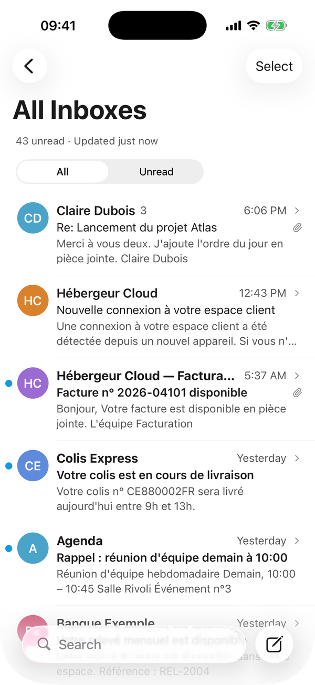 | 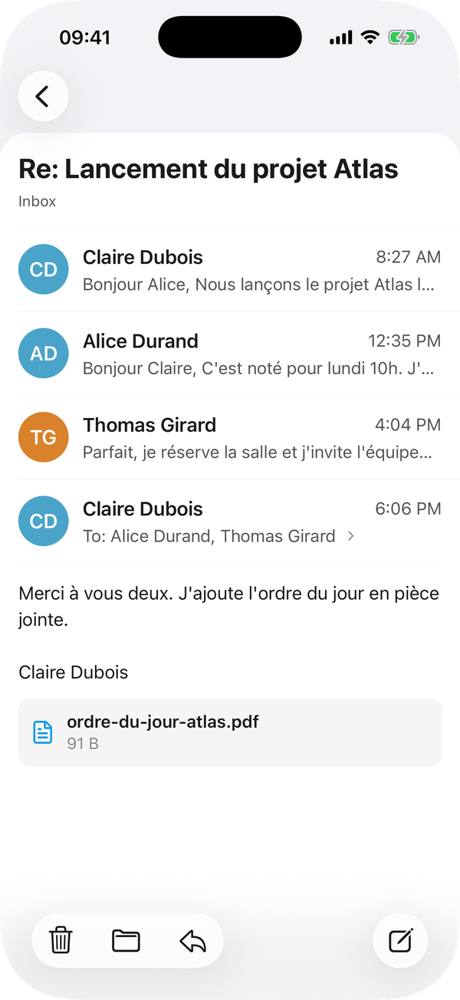 | 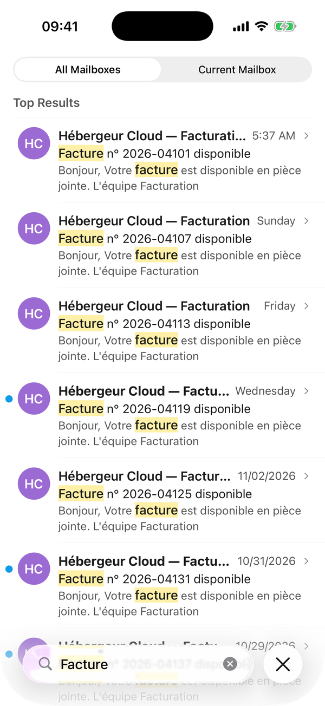 |

</div>

---

## Overview

**Open Mailbox** reads and sends your mail by talking directly to your provider's IMAP and SMTP
servers. There is no Open Mailbox server, no account to create and no relay in the middle: your
messages and passwords only travel between your phone and your mail providers.

All your accounts land in one unified inbox. Everything you do (read, flag, move, delete) is applied
on the phone at once and synced with the server in the background, so the app stays fast on a weak
connection and keeps working offline.

On iOS the app is built with the system's own Liquid Glass components: native headers, toolbars,
search, menus and long-press previews, in light and dark mode.

---

## ⚠️ Active development

> Open Mailbox is **under active development**. Behaviour and data formats may change between
> versions until a stable release is published.

---

## ✨ Features

### All your accounts, one inbox
- A unified inbox across every account, plus each account's own folders
- Sign-in for **Google**, **iCloud**, **OVHcloud**, **IONOS**, **Yahoo**, or any IMAP/SMTP account,
  with servers found automatically when possible
- A signature per account and a sender picker when you write
- Mail sorted on the device into **Primary, Transactions, Updates and Promotions**, with All Mail one tap
  away; sign-in codes, security alerts and bounces stay in Primary, and moving a sender to another
  category takes its past and future mail with it

### Fast, local-first mail
- Messages are stored on the device (SQLite) and searchable offline with full-text search, in the
  current mailbox or all of them, matches highlighted
- Every action is applied locally first, then replayed against the server
- Moves to the archive, trash, junk or any folder can be **undone for five seconds**

### Made for the phone
- Swipe actions, long-press preview with a menu of actions, multiple selection
- Mail-style round buttons when you swipe a message aside in a conversation
- Replies and forwards that keep the original's formatting
- Recipients suggested from past mail and from your contacts
- Contact pictures from Gravatar, else the logo the sender's company publishes for its mail (BIMI) or its
  website icon, else initials

### Attachments
- Opened in place when the phone can: an in-app viewer on iOS, the system's apps on Android
- Sent from photos or files, up to 25 MB; iPhone photos are sent as JPEG
- Kept when forwarding

### Privacy
- Remote images are blocked until you allow them, per message or in Settings
- Unsubscribe from mailing lists in one tap
- Contact pictures can be turned off in Settings

---

## 📱 Screenshots

<div align="center">

| Add an account | Mailboxes | Long-press preview |
| :---: | :---: | :---: |
| 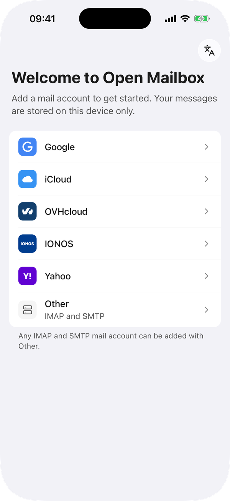 | 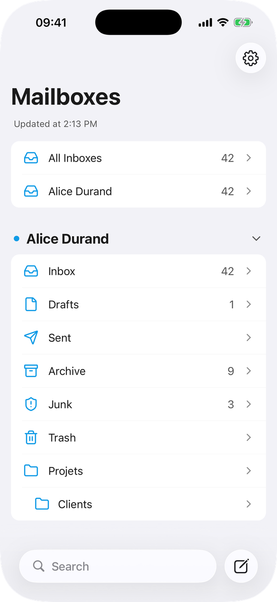 | 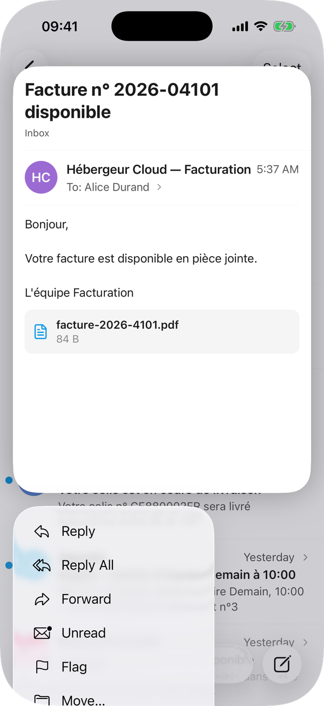 |

| Reply menu | Writing a reply | Swipe actions |
| :---: | :---: | :---: |
| 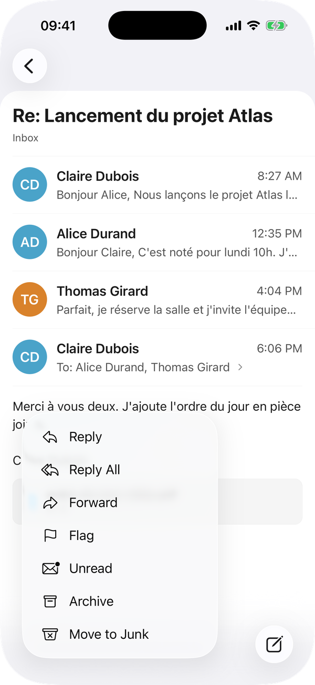 | 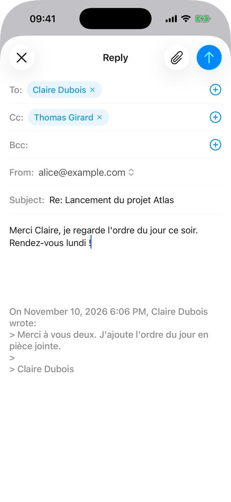 | 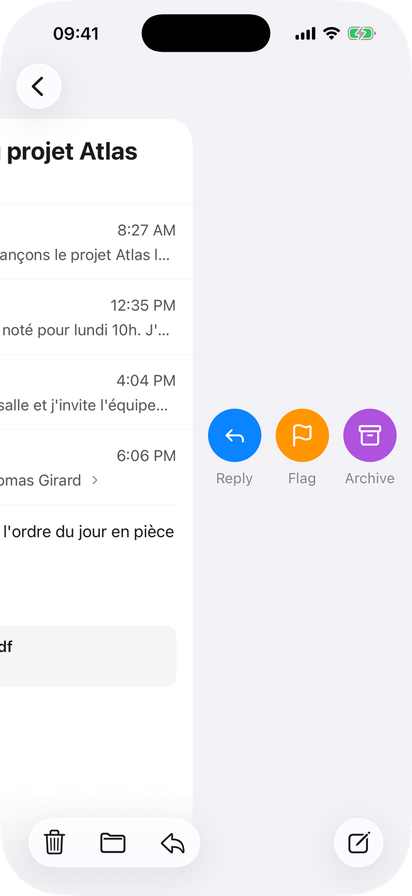 |

| Dark mode | Dark mode |
| :---: | :---: |
| 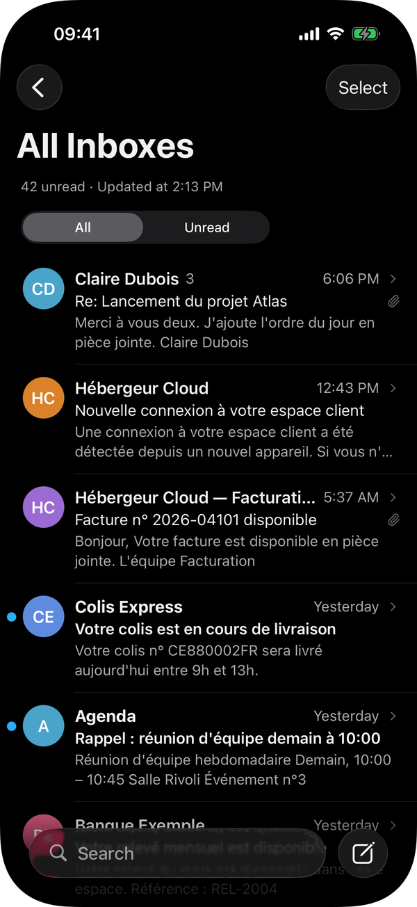 | 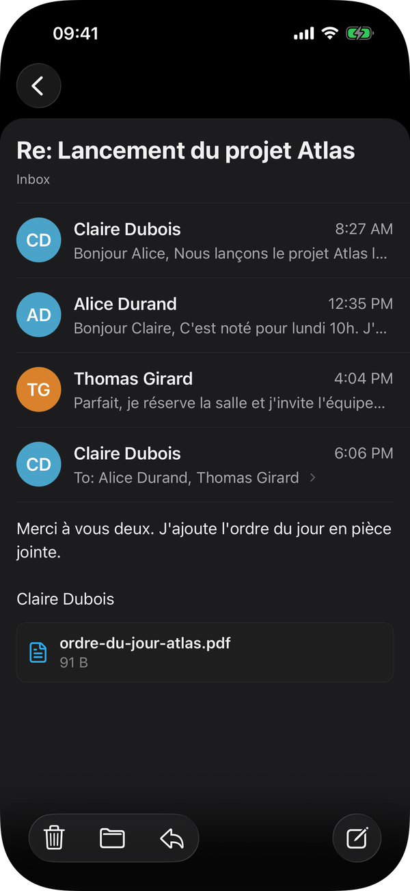 |

</div>

<sub>Screenshots show demo data from the local test server; every name and address in them is fictional.</sub>

---

## 🔔 Good to know

- **Notifications** rely on the system's background scheduling, since there is no push server:
  Android checks at best every 15 minutes and iOS less often, depending on how the app is used.
- **Contact pictures** tell Gravatar and company websites which addresses you write to, and
  Cloudflare's DNS resolver which company domains (for their BIMI logos). They are fetched once a month
  per address and can be turned off in Settings.
- **Microsoft accounts** need OAuth and are not supported yet.

---

## 🏗️ Architecture

The mail engine is written in Rust and shared by both platforms. The React Native app never reads
the database: it calls the core through JSI and refreshes when the core emits an event.

| Path | Content |
| --- | --- |
| `core/` | Rust workspace: storage (SQLite + FTS5), MIME, IMAP, SMTP, autoconfig, sync engine, uniffi facade |
| `modules/mail-core/` | React Native turbo module generated by uniffi-bindgen-react-native from `core/crates/mail-ffi` |
| `app/` | Expo Router screens |
| `src/` | React Native code: `core/` (bridge, queries, actions), `features/`, `ui/components/`, stores |
| `tools/` | Build script for the core and a local GreenMail test server |

---

## 🛠️ Build

### Requirements

- Node 22 and Yarn 4 (`corepack enable`)
- Rust through rustup; `core/rust-toolchain.toml` pins the version and targets, which `yarn core:*` installs
- Android: SDK, NDK 27 and `cargo install cargo-ndk`
- iOS: macOS with Xcode

### Run

```bash
yarn install
yarn core:android     # or yarn core:ios, on macOS
yarn android          # or yarn ios
```

`yarn core:*` must run again after any change in `core/`.

### iOS

The iOS side of `modules/mail-core` (`ios/`, `MailCore.podspec`) is generated and committed; the
Rust core itself is built into `OpenmailboxMailCoreFramework.xcframework`, which needs macOS with
Xcode. Installing on an iPhone for more than seven days needs a paid Apple Developer account.

```bash
yarn core:ios        # or yarn core:ios:dev to trust the local test server
npx expo run:ios --device
```

An EAS build needs the same framework, so build the core with `--release` before `eas build`:
`.easignore` uploads it with the project. Releases do this in `.github/workflows/expo.yml`.

### Local test server

`yarn mail:start` runs GreenMail in Docker (IMAPS on 3993, SMTPS on 3465) and seeds it with demo
mail for `alice@example.com` (password `secret`). Development builds list it on the welcome screen.
`yarn mail:seed` resets its content.

---

## ✅ Tests

```bash
cd core && cargo test --workspace
yarn test
yarn typecheck
```

App tests live in `__tests__/`, grouped like the sources, and use Jest with React Native Testing
Library. They load the generated bindings for their types but replace the core itself with the fake
in `jest.setup.js`, so they run without a native build.

---

## 📄 License

The app is under the [Mozilla Public License 2.0](LICENSE). The Rust core in `core/` is under the
[Apache License 2.0](core/LICENSE), so its crates can be reused in other projects.
